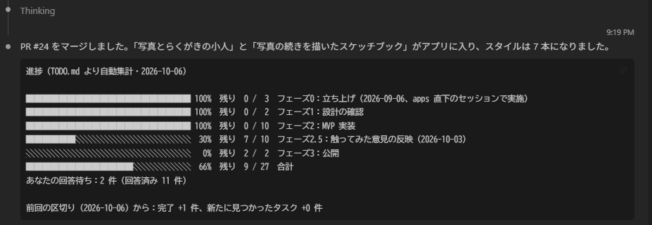

# claude-code-toolkit

**English:** Claude Code plugins and skills that I use every day, packaged so that anyone can install them.
Each tool lives in its own plugin, so you install only what you need. Add this repository as a marketplace with
`claude plugin marketplace add n-yoshida-dev/claude-code-toolkit`, then install a plugin with `claude plugin install <name>@yoshida-toolkit`.
Documentation is mainly in Japanese; each plugin README starts with an English summary. MIT licensed.

---

[n-yoshida-dev](https://github.com/n-yoshida-dev) が個人開発で毎日使っている Claude Code のプラグインとスキルを、ほかの人も導入できる形にしたものです。
道具ごとに 1 つのプラグインに分けてあるので、要るものだけを入れられます。

## プラグイン一覧

| 名前 | できること | 入っているもの | イメージ |
|---|---|---|---|
| [todo-progress](plugins/todo-progress/) | `TODO.md` のチェックボックスを見出しごとに数え、進捗バー・残り件数・公開までの残り・前回の区切りからの増減を表にする。セッションの開始時に Claude が最初の返答で見せる | フック（SessionStart）、スキル `/todo-progress:progress` |  |

## 導入

Claude Code のセッションの中で、このリポジトリをマーケットプレイス（プラグインの一覧）として登録し、使いたいプラグインを入れます。

```
/plugin marketplace add n-yoshida-dev/claude-code-toolkit
/plugin install todo-progress@yoshida-toolkit
```

ターミナルからなら `claude plugin marketplace add …` と `claude plugin install …` で同じことができます。
設定項目や使い方は、各プラグインの README にあります。

## 更新

```bash
claude plugin marketplace update yoshida-toolkit
claude plugin update <プラグイン名>@yoshida-toolkit
```

## 安全について

フックは、あなたの権限でシェルスクリプトを実行します。各プラグインの README の「このプラグインが実行するもの」に、
読むもの・書くもの・ネットワークへの接続の有無を書いています。入れる前に確かめてください。

## 構成

```
.claude-plugin/marketplace.json   公開しているプラグインの一覧
plugins/<名前>/                   プラグイン本体（.claude-plugin/plugin.json・hooks/・scripts/・skills/・README・LICENSE）
.github/workflows/ci.yml          JSON・shellcheck・回帰テスト・claude plugin validate --strict
```

## 不具合・要望

[Issues](https://github.com/n-yoshida-dev/claude-code-toolkit/issues) へどうぞ。日本語でも英語でも構いません。

## License

[MIT](LICENSE)
